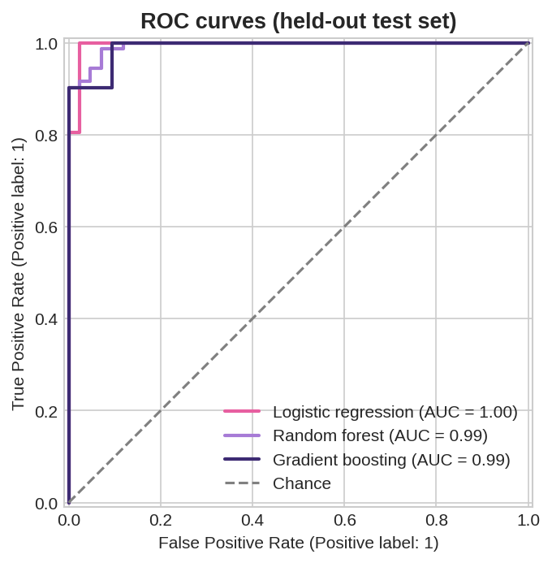
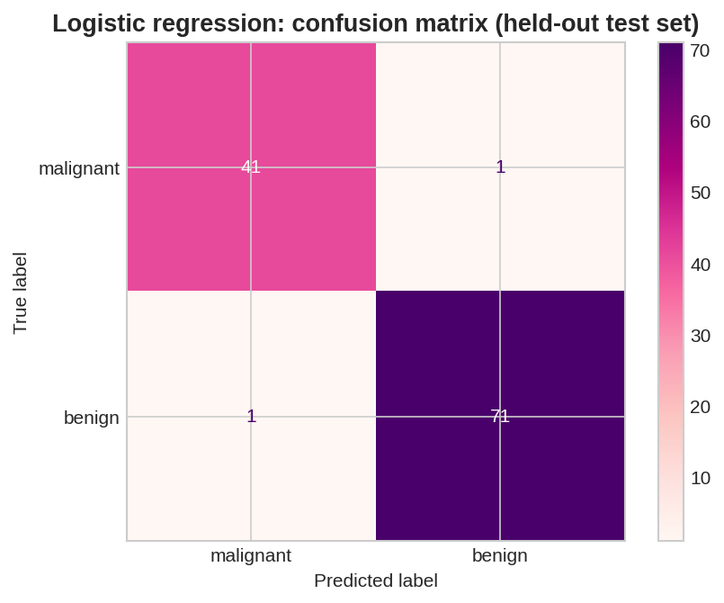
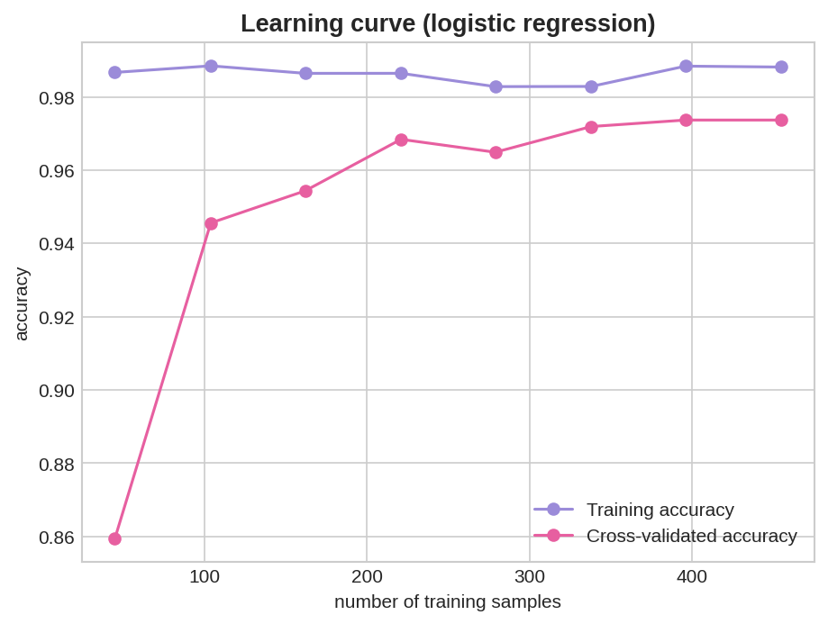
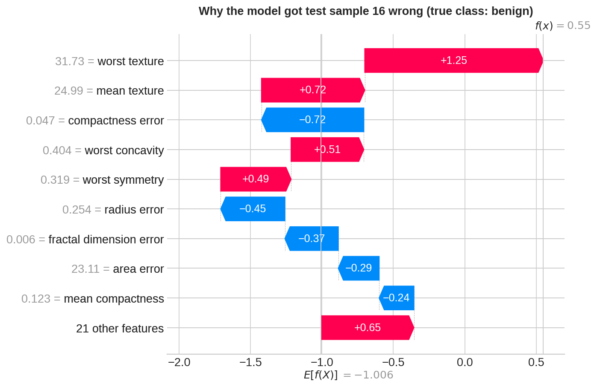

# 🌸 Breast Cancer Tumor Classification

**Comparing machine learning models on 569 tumor samples, with a focus on catching malignant cases.**

[Open in Colab](https://colab.research.google.com/github/izmahnaweed-oss/breast-cancer-classification/blob/main/breast_cancer_classification.ipynb)

## 🔬 Overview
I compared several machine learning models on the Breast Cancer Wisconsin dataset to see which best tells malignant tumors from benign ones, and I looked closely at the mistakes they make. I'm interested in biomedical research, so I wanted to see how machine learning works on real medical data and where it goes wrong.

*I started from a short tutorial notebook that trained a random forest. I added the model comparison, cross-validation, nested cross-validation, error analysis, cutoff and feature experiments, a learning curve, and SHAP explanations.*

## 🧬 Dataset
569 tumor samples (212 malignant, 357 benign), each with 30 numeric measurements of cell nuclei taken from images. Loaded from scikit-learn. About 63% of samples are benign, so a model that always guessed "benign" would already score about 63%.

## 🧪 Method
- Held out 20% of the data as a test set, with a fixed random seed so results can be reproduced
- Compared 4 models plus a baseline using 5-fold cross-validation repeated 3 times
- Used **malignant recall** (the share of real cancers caught) as the key metric, because a missed cancer is worse than a false alarm
- Checked for over-optimistic scores using nested cross-validation

## 📊 Results (cross-validated)
| Model | Accuracy | Malignant recall | Malignant precision | ROC AUC |
| --- | --- | --- | --- | --- |
| Logistic regression | 97.60% | 95.12% | 98.41% | 0.995 |
| Random forest | 95.96% | 93.57% | 95.66% | 0.990 |
| Gradient boosting | 95.78% | 92.62% | 96.04% | 0.992 |
| Decision tree | 92.85% | 89.79% | 90.90% | 0.922 |
| Baseline (always "benign") | 62.74% | 0.00% | 0.00% | 0.500 |

Logistic regression performed best on every metric. The random forest and gradient boosting were about tied. A likely reason is that this dataset is small and clean, so a simple model works well, though I did not test that directly.

**Nested cross-validation** (tuning inside an inner loop, scoring in an outer loop): 97.02% accuracy, 93.88% malignant recall, 98.11% malignant precision. Tuning chose the default setting (C = 1), so it changed nothing. I treat about 97% accuracy and 94% recall as the more honest estimates.

## 🔍 Where the model makes mistakes
On the held-out test set (114 tumors), logistic regression got 112 right: it caught 41 of 42 cancers and raised 1 false alarm.

- **The missed cancer** had mixed signals. Its texture and radius error looked benign, while its concavity and perimeter fell between the benign and malignant averages. The model gave it a 9% chance of being malignant.
- **The false alarm** was a benign tumor with high texture and concavity values. The model was unsure (63% malignant).

With only two errors in 114 samples, I can't draw strong conclusions about why they happened. They look like borderline cases.

## 🧠 Which measurements matter

The features the logistic regression weighted most strongly toward **malignant** were worst texture, radius error, worst concave points, worst area, and worst radius. The features weighted most strongly toward **benign** were mean compactness, compactness error, fractal dimension error, symmetry error, and texture error. Radius and area describe the size of a nucleus, texture is how much its brightness varies, concave points count the dents in its outline, compactness is how tightly packed the shape is, and fractal dimension is how rough the outline is. "Worst" is the mean of the three largest values in an image, and "error" is the standard error of a measurement. These are what the model weighted, not proof of what causes cancer. Many of the measurements overlap (radius, area, and perimeter, or compactness, concavity, and concave points), so the direction of any single feature should be read with caution.

## ⚗️ Extra experiments
**Lowering the cutoff.** I tested flagging tumors as malignant at lower probabilities. The missed cancer stayed missed even at a 10% cutoff, and false alarms rose from 1 to 11.

**Fewer measurements.** Using 20 of the 30 features gave almost the same results (97.54% accuracy, 95.12% malignant recall). With only 3 features, accuracy fell to 93.73% and malignant recall to 90.42%.

**Would more data help?**

The cross-validated accuracy flattens out as the training set grows, so adding more samples would probably not improve this model much.

**Explaining a single prediction (SHAP).**

This plot explains the false alarm: a benign tumor that the model gave a 63% chance of being malignant. Red bars push toward malignant and blue bars toward benign. Its worst texture (31.7, higher than the average malignant tumor in this dataset) was the biggest push toward malignant, followed by mean texture, worst concavity, and worst symmetry. Compactness error, radius error, fractal dimension error, and a few others pulled toward benign, but not enough to cancel those out.

## ⚠️ Limitations
- Small, clean dataset from one source
- Even the best model missed about 1 in 20 cancers in cross-validation, which would not be acceptable in real use
- Only 114 test samples, so a single error moves the numbers a lot
- This is an educational project and is not a diagnostic tool

## 💡 What I learned
A simple model can beat more complex ones on a small, clean dataset, and accuracy alone isn't enough. In medicine, what matters is which mistakes the model makes. Next I want to apply the same approach to a pharmaceutical dataset.

## ▶️ How to run
Open `breast_cancer_classification.ipynb` in Google Colab and choose **Runtime → Run all**. Everything is included, so there's nothing to set up.

## 📁 Files
- `breast_cancer_classification.ipynb`: the full analysis
- `model_comparison.csv`: cross-validated results table
- `*.png`: charts used above
